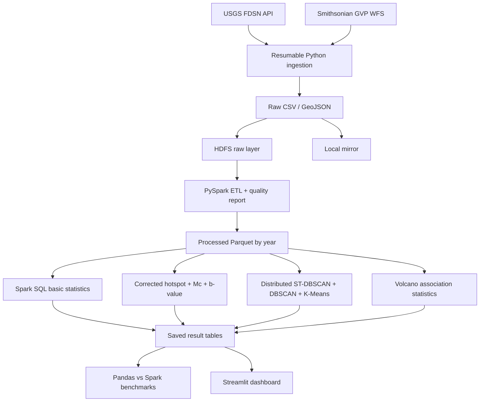

# Big Data Analytics for Global Earthquake Patterns and Their Association with Volcanic Activity

An end-to-end academic Big Data project using the **USGS FDSN earthquake
catalogue** and the **Smithsonian Global Volcanism Program**.  It demonstrates
Hadoop HDFS storage, PySpark ETL, Spark SQL analytics, detection-corrected
hotspot analysis, a custom distributed space–time DBSCAN, volcano–earthquake
association statistics, controlled Pandas/Spark benchmarking and an interactive
Streamlit dashboard.

> **Scope statement.** This project describes and tests statistical
> associations. It does **not** predict earthquakes or volcanic eruptions and
> does not claim causation.

> **Status.** All 15 phases are executed or documented on the real full dataset:
> 689,501 raw global records → 681,902 processed; 2,442 hotspot groups;
> 119,765-event distributed ST-DBSCAN run; 941-eruption volcano analysis;
> 88-measurement global benchmark; Alaska/California stress data processed.
> See `PROJECT_STATUS.md` and `docs/RESULTS.md` for measured results. Only
> results backed by real output files are reported.

## 1. Research objectives

### Measured headline results (full data)

| Result | Measured value | File |
|---|---|---|
| Global raw records | 689,501 (exact USGS count) | `data/raw/.../_manifest.json` |
| Processed records | 681,902 | `results/metadata/preprocessing_earthquakes_global.json` |
| 5° hotspot groups / eligible | 2,442 / 586 | `results/hotspots/summary.json` |
| Median Mc / b-value | 4.55 / 0.987 | `results/hotspots/summary.json` |
| Apparent growth lost after Mc correction | 44 cells | `results/hotspots/region_growth_comparison.csv` |
| ST-DBSCAN clusters / noise | 494 / 98,583 (119,765-event sample) | `results/clustering/metrics.json` |
| Distributed vs reference ARI | 0.999991 | `results/clustering/metrics.json` |
| Volcano eruptions analysed | 941 | `results/volcano/summary.json` |
| Benchmark | Pandas faster on every 681k-row operation | `results/benchmarks/global/benchmark_report.md` |


1. Build a reproducible Big Data pipeline from official source APIs to HDFS,
   Spark Parquet, analytics and a dashboard.
2. Measure global earthquake patterns for 2000–2025 (M ≥ 2.5), including
   magnitude/depth distributions, temporal trends and geographic hotspots.
3. Correct raw hotspot rankings for magnitude-of-completeness (Mc) differences
   and estimate Gutenberg–Richter b-values by region and time window.
4. Implement and validate a **distributed ST-DBSCAN** on Spark, with Haversine
   spatial distance, temporal proximity, halo partitions and Union–Find merging.
5. Test volcano-specific earthquake rate changes before/after eruptions using
   five-year baselines, rate ratios, confidence intervals, Poisson tests and
   permutation tests. This is association analysis, not eruption prediction.
6. Benchmark Pandas vs Spark on identical data, formats, partition counts and
   caching settings, reporting actual measured timings.

## 2. Data sources

| Dataset | Source | Access | Retrieved |
|---|---|---|---|
| Earthquakes | USGS FDSN Event Web Service | `https://earthquake.usgs.gov/fdsnws/event/1/query` | Script records exact timestamps |
| Volcanoes / eruptions | Smithsonian GVP, Volcanoes of the World | Official WFS `https://webservices.volcano.si.edu/geoserver/GVP-VOTW/ows` | Script records exact timestamps |

The USGS global query is monthly, global, `2000-01-01`–`2025-12-31`,
`minmagnitude=2.5`. The measured count is **689,501** (2026-11-19). Raw
responses are stored unchanged; no data are invented.

The Smithsonian website itself returns a bot challenge to scripts. The official
GVP GeoServer WFS is used instead; it reports **1,214** Holocene volcanoes and
**11,089** Holocene eruptions. The GVP citation is recorded in
`config/config.yaml` and in download manifests.

## 3. Architecture



**Execution mode.** Spark runs in `local[6]` mode: real parallel computation
across Spark partitions on one machine, not a multi-node cluster. HDFS runs as
a single-node development NameNode/DataNode. The project never labels local
files as HDFS.

## 4. Repository layout

```
earthquake_bigdata/
├── config/                 config.yaml, logging.yaml
├── common/                 config, logging, Spark, geo, I/O helpers
├── ingestion/              USGS + GVP downloaders, validation
├── preprocessing/          earthquake_etl.py, volcano_etl.py
├── storage/                HDFS manager, Parquet publisher
├── analytics/              statistics, Mc/b-value, hotspots, DBSCAN, ST-DBSCAN, volcano
├── benchmarking/           Pandas/Spark benchmarks and report
├── dashboard/              Streamlit app and pages
├── data/
│   ├── raw/                original downloaded responses
│   ├── processed/          Parquet (local mirror)
│   ├── sample/             real 10k sample + volcano sample
│   └── stress_test/        Alaska/California scalability data
├── results/                saved metrics, tables, figures, metadata
├── tests/                  pytest unit + integration tests
├── scripts/                HDFS start/stop, helpers
├── docs/                   environment, datasets, methodology, results
├── requirements.txt
├── main.py
└── PROJECT_STATUS.md
```

## 5. Installation

### 5.1 Python environment (Windows PowerShell)

```powershell
cd C:\ISHU\Education\Amrita\5th_Sem\BigData\Project\earthquake_bigdata
python -m venv --system-site-packages .venv
.\.venv\Scripts\python.exe -m pip install -r requirements.txt
```

The venv deliberately pins pandas 2.2.3 because PySpark 4.2 warns that pandas 3
is not fully supported. Use the venv Python for every command below.

### 5.2 Java / Hadoop / Spark

* Java **17** is required by Spark 4.2. The project auto-detects a JDK 17+
  installation (see `common/spark.py`); `config.yaml` records the discovered
  Windows path.
* Hadoop 3.3.6 is installed at `C:\hadoop\hadoop-3.3.6` with `winutils.exe`.
* PySpark 4.2.0 is installed in the Python environment.
* HDFS is configured for `hdfs://localhost:9000` with one DataNode.

Start HDFS:

```powershell
.\scripts\start_hadoop.ps1
```

This starts NameNode/DataNode if needed, leaves safe mode, creates
`/earthquake/{raw,processed}`, `/volcano/{raw,processed}` and `/results`, and
prints the HDFS root listing. Stop with `.\scripts\stop_hadoop.ps1`.

### 5.3 Storage fallback

`storage.backend` is `auto`: HDFS is used if reachable, otherwise the pipeline
falls back to **local** storage and records `backend=local` in metadata. Force
local with `$env:EARTHQUAKE_STORAGE_BACKEND="local"`; force HDFS (fail if down)
with `"hdfs"`. Local storage is never described as HDFS.

## 6. Execution

### 6.1 Download the real 10k sample (Phase 3)

```powershell
.\.venv\Scripts\python.exe -m ingestion.download_earthquakes --dataset sample
.\.venv\Scripts\python.exe -m ingestion.download_volcanoes --sample
.\.venv\Scripts\python.exe -m ingestion.validate_downloads --strict
```

The sample uses 13 real monthly files spanning 2000–2024, then a deterministic
proportional stratified sample by month and magnitude bin (~10,000 rows).

### 6.2 Download the full global dataset

```powershell
.\.venv\Scripts\python.exe -m ingestion.download_earthquakes --dataset global
```

Monthly requests are resumable. Existing files with matching manifest hashes
and row counts are skipped.

### 6.3 Download the Alaska/California stress-test data

```powershell
.\.venv\Scripts\python.exe -m ingestion.download_earthquakes --dataset stress_all
```

Stress-test data are **not** mixed into global scientific findings.

### 6.4 Preprocess

```powershell
.\.venv\Scripts\python.exe -m preprocessing.earthquake_etl --dataset sample_10k
.\.venv\Scripts\python.exe -m preprocessing.volcano_etl
```

Then `--dataset global`, `stress_all` for the larger runs.

### 6.5 Analytics, benchmarks and dashboard

The `main.py` entry point wraps all verified commands:

```powershell
# Environment and HDFS smoke test
.\.venv\Scripts\python.exe main.py env --smoke
.\.venv\Scripts\python.exe main.py hadoop-start

# Sample pipeline (real data)
.\.venv\Scripts\python.exe main.py download-sample
.\.venv\Scripts\python.exe main.py download-volcanoes
.\.venv\Scripts\python.exe main.py validate --strict
.\.venv\Scripts\python.exe main.py etl sample
.\.venv\Scripts\python.exe main.py etl volcanoes
.\.venv\Scripts\python.exe main.py stats --dataset sample_10k
.\.venv\Scripts\python.exe main.py hotspots --dataset sample_10k
.\.venv\Scripts\python.exe main.py cluster --dataset sample_10k
.\.venv\Scripts\python.exe main.py volcano --dataset sample_10k
.\.venv\Scripts\python.exe main.py benchmark --dataset sample_10k --quick

# Full global pipeline (only after the sample pipeline passes)
.\.venv\Scripts\python.exe main.py download-global
.\.venv\Scripts\python.exe main.py validate --strict
.\.venv\Scripts\python.exe main.py etl global
.\.venv\Scripts\python.exe main.py stats --dataset global
.\.venv\Scripts\python.exe main.py hotspots --dataset global
.\.venv\Scripts\python.exe main.py cluster --dataset global
.\.venv\Scripts\python.exe main.py volcano --dataset global
.\.venv\Scripts\python.exe main.py benchmark --dataset global

# Dashboard (reads saved results only)
.\.venv\Scripts\python.exe main.py dashboard
```

Raw data can be downloaded locally first and uploaded in one batch to avoid
per-file Hadoop CLI startup:

```powershell
.\.venv\Scripts\python.exe -m ingestion.download_earthquakes --dataset global --no-hdfs
.\.venv\Scripts\python.exe scripts\upload_raw_to_hdfs.py --dataset global
```

Stress-test data use `--dataset stress_all` and are kept separate.

```powershell
.\.venv\Scripts\streamlit.exe run dashboard\app.py
```

## 7. Configuration

All paths and parameters are in `config/config.yaml`; no path is hard-coded in
analysis code. Environment overrides:

| Variable | Effect |
|---|---|
| `EARTHQUAKE_CONFIG` | Alternative YAML config |
| `EARTHQUAKE_STORAGE_BACKEND` | `auto`, `hdfs`, `local` |
| `EARTHQUAKE_SPARK_MASTER` | e.g. `local[8]` |
| `EARTHQUAKE_DRIVER_MEMORY` | e.g. `6g` |
| `SPARK_JAVA_HOME` | JDK 17+ path |

## 8. Scientific limitations (summary)

* Detection-corrected rates use the maximum-curvature Mc estimate plus the
  standard +0.2 correction; Mc is uncertain and is reported with bootstrap
  intervals and goodness-of-fit diagnostics.
* Magnitude scales are not blindly combined: the hotspot module requires a
  dominant scale family per cell/window and reports cells that fail.
* ST-DBSCAN partitions the globe spatially with halo events; correctness is
  checked against a single-machine reference. Cluster labels are arbitrary;
  equivalence is evaluated with Adjusted Rand Index. On the 9,882-event sample
  ARI was exactly 1.0; on the 119,765-event bounded global run ARI was
  0.999991 (core-point ARI 0.998728), with a few border/core-boundary
  assignments differing. This limitation is reported, not hidden.
* Volcano analysis is observational: five-year volcano-specific baselines,
  90-day pre- and 180-day post-eruption windows, rate ratios, CIs, Poisson and
  permutation tests, FDR correction. Sparse counts and date uncertainty are
  reported, not hidden.
* Benchmark results are actual wall-clock measurements on the stated hardware;
  Spark startup overhead and data loading are measured and reported separately
  where possible. Pandas may be faster on small data and this is reported.

## 9. Known environment limitations

* HDFS is a single-node Windows development setup with replication 1.
* Spark is local mode, not a multi-machine cluster.
* The machine has 16 GB RAM; full-data clustering is bounded to a documented
  deterministic sample to avoid memory exhaustion.
* The Smithsonian website blocks automated scraping; the official WFS is used
  instead.

See `docs/ENVIRONMENT.md` for measured hardware/software details.
