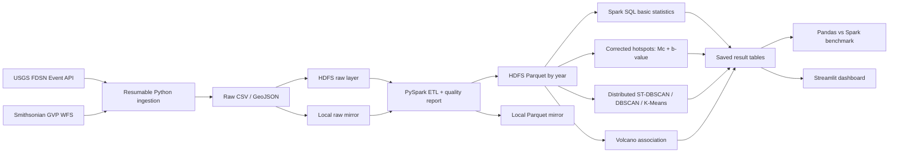
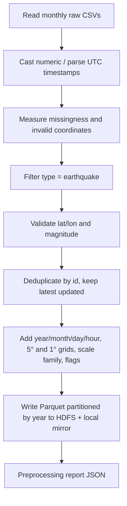
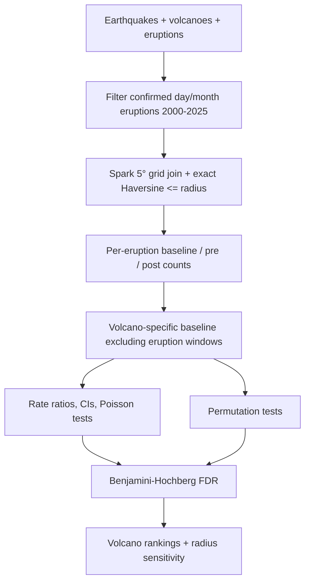
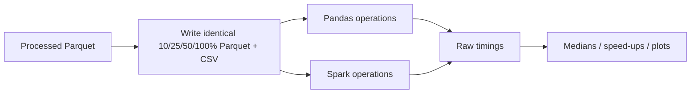

# Architecture and data flow

## System architecture



**Important distinction:** Spark runs in `local[6]` mode on a single Windows
machine. Work is partitioned and parallel across threads, but this is not a
multi-node cluster. HDFS is a single NameNode + one DataNode with replication 1.

## Storage layout

```
HDFS
/earthquake/raw/global/{year}/{year}-{month}.csv
/earthquake/raw/stress/{region}/{year}/...
/earthquake/processed/{dataset}/year=.../*.parquet
/volcano/raw/{volcanoes|eruptions}/*.geojson
/volcano/processed/{volcanoes|eruptions}/*.parquet
/results/{hotspots,clustering,volcano,...}
```

The local worker also keeps a mirror under `data/processed/` so the dashboard
does not depend on HDFS being up. Every dataset write records the actual backend
in `results/metadata/`.

## Earthquake ETL flow



## Distributed ST-DBSCAN flow

```mermaid
flowchart TD
    A[Events with id, lat, lon, time] --> B[Assign primary + 1-ring halo cells]
    B --> C[Spark groupBy cell_id / applyInPandas]
    C --> D[Local exact ST-DBSCAN per cell]
    D --> E[Local cluster keys cell|label]
    E --> F[Union-Find over keys sharing an event id]
    F --> G[Global stable cluster ids]
    G --> H[Compare with single-machine reference: ARI]
    G --> I[Cluster statistics, maps, sensitivity]
```

## Volcano association flow



## Benchmark flow



## Reproducibility controls

* Every path and parameter comes from `config/config.yaml`.
* Downloads are resumable and hashed.
* Every ETL and analytics output is saved as JSON/CSV/Parquet.
* Random operations use explicit seeds.
* Tests use synthetic data only for unit correctness; real data are used for
  integration runs.
* Results files record generation time, parameters and backend.
